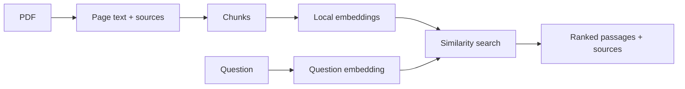

# AI Ingestion Engine

A Python pipeline that turns PDF content into searchable passages while preserving the source filename and page number.

The current prototype supports PDF text extraction, chunking, local embeddings and passage retrieval. The broader project will add video ingestion and retrieval-augmented generation (RAG): answers written from retrieved evidence with source references.

## Implemented

- Extract selectable PDF text page by page with PyMuPDF.
- Save extracted text and source details as UTF-8 JSON.
- Split text at paragraph boundaries, with bounded word windows and overlap for long paragraphs.
- Generate local EmbeddingGemma embeddings through Ollama.
- Retrieve passages using either a keyword baseline or cosine similarity between question and passage embeddings.
- Display each result's filename, page, chunk number and score alongside its original text.



## Run locally

Requires Python 3.12 and [Ollama](https://ollama.com/download). Keep Ollama running while generating embeddings or using semantic search. The embedding model runs on the local machine.

From the repository root:

```bash
python3.12 -m venv .venv
source .venv/bin/activate
python -m pip install -r requirements.txt
ollama pull embeddinggemma:300m
```

Prepare the included fictional policy document and build its search data:

```bash
mkdir -p storage/uploads
cp examples/sample.pdf storage/uploads/sample.pdf
python app/parsers/pdf_parser.py
python app/chunking/chunker.py
python app/embeddings/embedding_client.py
```

Run semantic search:

```bash
python -m app.retrieval.semantic_search
```

Enter a question at the prompt, for example:

```text
What does the warranty cover?
```

To compare with keyword search:

```bash
python app/retrieval/keyword_search.py
```

Extracted pages, chunks and embeddings are generated under `storage/`, which is excluded from version control. Rebuild embeddings whenever the chunk text or embedding model changes. The current command-line scripts use the sample file paths shown above.

## Current limitations

- Verified on a small English, selectable-text PDF. Different layouts, columns and tables require further extraction and chunking checks; image-only scans require OCR.
- Paragraph boundaries currently rely on blank lines in extracted text. This is a heuristic, not full document-layout understanding.
- Semantic search returns candidate passages, not generated answers. Similarity scores do not guarantee that the first passage directly answers the question; retrieval quality remains under evaluation.

## Planned scope

- Scanned PDFs and embedded-image text through OCR.
- Video speech transcription and visual/on-screen content extraction, preserving timestamps.
- Arabic, English and French document/video processing, retrieval and answers, including cross-language evaluation.
- RAG answers with source references, summaries and meeting notes.
- Qdrant indexing, Neo4j graph-assisted retrieval, linked Markdown notes and n8n workflows.
